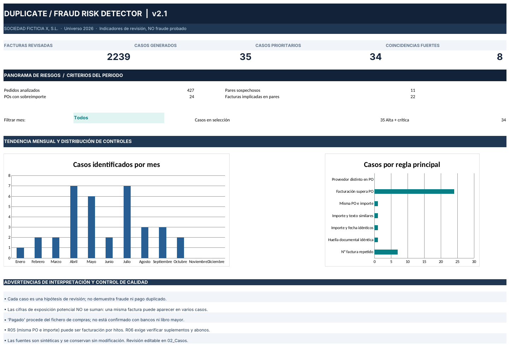

# Duplicate & Fraud Risk Detector

**Proyecto 02 de auditoría automatizada · Sociedad Ficticia X, S.L. · Universo 2026 · datos 100 % sintéticos · v2.1**

Motor de cribado que identifica posibles facturas duplicadas, facturación superior al pedido y discrepancias de proveedor. Prioriza cada caso con un score y lo deja preparado para su revisión documental, con seguimiento persistente entre ejecuciones.

> Los resultados son **señales que requieren corroboración**, no conclusiones de fraude, pagos duplicados ni errores materiales.

**Caso práctico completo:** [ericcardenosa.github.io/#duplicados](https://ericcardenosa.github.io/#duplicados)



---

## Resultados de la demostración

| Indicador | Resultado |
|---|---:|
| Facturas revisadas | 2.239 |
| Pedidos de compra | 427 |
| Casos de revisión | 35 |
| · Pares de facturas | 11 |
| · POs con facturación superior al pedido | 24 |
| Casos críticos (score ≥ 90) | 8 |
| Casos de prioridad alta o crítica | 34 |
| Pruebas automáticas | 7 (superadas) |

Estos recuentos corresponden a esta versión de los cuatro ficheros de demostración. Cambiar importes, umbrales, fechas o relaciones altera las cifras.

## Reglas de detección

| Código | Regla | Score base | Evidencia esencial |
|---|---|---:|---|
| R01 | Mismo proveedor y número de factura | 95 | Factura original y asiento contable |
| R02 | Huella documental idéntica (proveedor, fecha, importe y concepto) | 92 | Número, serie, impuestos y concepto |
| R03 | Proveedor, fecha e importe idénticos | 74 | Concepto de cada prestación |
| R04 | Mismo importe, fechas a ≤ 7 días y concepto similar (≥ 0,86) | 64 | Contrato y periodo de prestación |
| R05 | Misma PO e importe en dos facturas | 69 | Entregas o hitos facturables |
| R06 | Facturas vinculadas por encima del total de la PO | 78 | Adendas, suplementos y abonos |
| R07 | Proveedor de la PO distinto al de la factura | 62 | Autorización de tercero facturador |

Un par de facturas genera **un único caso** aunque active varias reglas; el score parte de la regla principal y suma ajustes acotados (+4 si comparten PO, +2 si ambas figuran como pagadas, +10 en R06 si el exceso supera el 25 % de la PO). Las exposiciones **no son aditivas**: una factura puede intervenir en varios casos.

## Estructura

```text
duplicate-fraud-risk-detector/
├── fraud_detector.py                 # Motor de reglas y generador del Excel
├── src/source_reader.py              # Lectura y normalización de las fuentes
├── scripts/
│   ├── create_demo_scenarios.py      # Escenarios de prueba R02–R05 (idempotente)
│   └── exportar_seguimiento.py       # Conserva el trabajo del revisor entre ejecuciones
├── tests/test_detector.py            # 7 pruebas de integración y casos límite
├── inputs/
│   ├── X_DEMO_*.xlsx                 # Cuatro fuentes sintéticas
│   └── seguimiento_casos.csv         # Revisiones por identificador de caso
├── output/
│   ├── DUPLICATE_RISK_2026.xlsx      # Informe de 12 hojas, listo para abrir
│   └── run_summary.json
├── docs/
│   ├── Manual_Usuario_Duplicate_Risk.pdf
│   └── vista_dashboard.png
└── requirements.txt
```

## Ejecución

Requiere Python 3.10 o superior.

```bash
pip install -r requirements.txt
python fraud_detector.py --input-dir inputs --output output/DUPLICATE_RISK_2026.xlsx
python -m unittest discover -s tests -v
```

Parámetros configurables:

```bash
python fraud_detector.py --days 7 --min-similarity 0.86 --threshold 1.00
```

## Flujo de revisión sin perder anotaciones

1. Abre `output/DUPLICATE_RISK_2026.xlsx` y revisa `02_Casos`.
2. Completa **Estado revisión**, **Responsable**, **Evidencia** y **Conclusión / notas**.
3. Antes de regenerar el informe, exporta el seguimiento:
   ```bash
   python scripts/exportar_seguimiento.py --report output/DUPLICATE_RISK_2026.xlsx --dest inputs/seguimiento_casos.csv
   ```
4. Ejecuta `python fraud_detector.py`: las anotaciones se recuperan por identificador estable.

## Origen de los datos

Se usan exclusivamente los ficheros ficticios `X_DEMO` compartidos con el proyecto [P2P Audit Engine](https://github.com/ericcardenosa/p2p-audit-engine). Para que las reglas R02–R05 tengan casos visibles, `scripts/create_demo_scenarios.py` reescribe ocho registros de la copia de facturas sin alterar pestañas, cabeceras ni número de filas. Los casos R01 y R06 proceden de la muestra original. Las huellas SHA-256 de los cuatro ficheros quedan registradas en la hoja `12_Trazabilidad`.

## Marco de referencia

El diseño se inspira en las NIA-ES: responsabilidades del auditor respecto al fraude (NIA-ES 240), identificación y valoración de riesgos (NIA-ES 315), evidencia (NIA-ES 500) y documentación (NIA-ES 230). Es una referencia orientativa: el proyecto no constituye un trabajo realizado conforme a estas normas.

## Limitaciones

- No hay libro mayor ni extractos bancarios: *Pagado ERP* **no es confirmación de pago**.
- No hay PDFs de facturas ni contratos: la duplicidad no puede confirmarse solo con metadatos.
- La coincidencia por proveedor presupone que el nombre está normalizado.
- Una factura que cita varias POs se prorratea en partes iguales como hipótesis de trabajo.
- El score es **heurístico**, no una probabilidad de fraude validada empíricamente.

## Historial de versiones

- **v2.1** · Lectura y escritura con `openpyxl` (sustituye a una librería no publicada); módulos auxiliares, escenarios y pruebas incluidos en el repositorio.
- **v2.0** · Siete reglas puntuadas, registro central de casos y seguimiento persistente.

El manual en PDF se redactó para la v2.0; el contenido funcional es el mismo, salvo la dependencia, que ahora es `openpyxl`.

---

### English summary

Screening engine that compares 2,239 synthetic invoices in pairs, applies seven scored rules and prioritises 35 review cases with stable identifiers and review tracking that survives regeneration. Results are review signals, not conclusions of fraud. Run `pip install -r requirements.txt` and `python fraud_detector.py`.

**Autor:** [Eric Cardeñosa Pizarro](https://ericcardenosa.github.io) · [LinkedIn](https://www.linkedin.com/in/ericcardenosapizarro)
